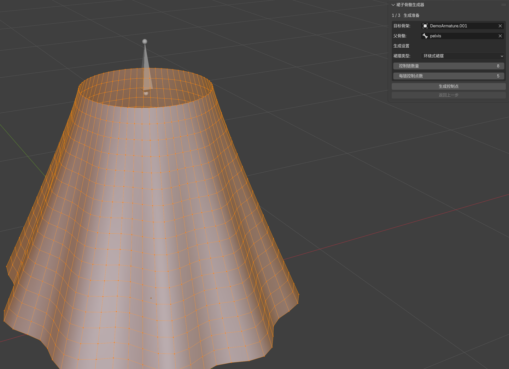
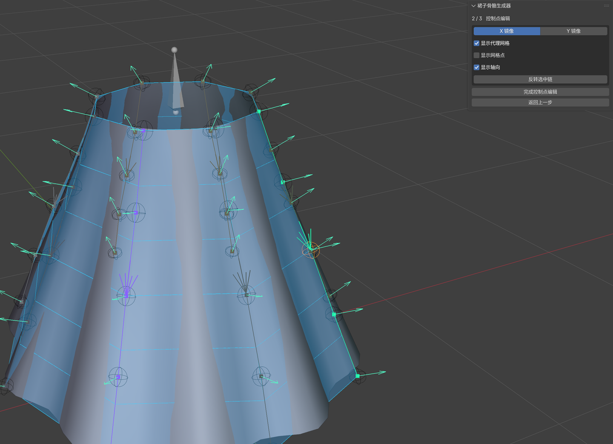
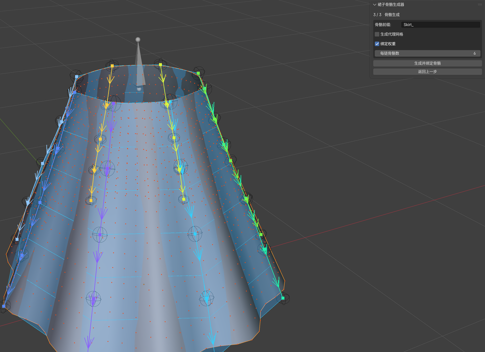
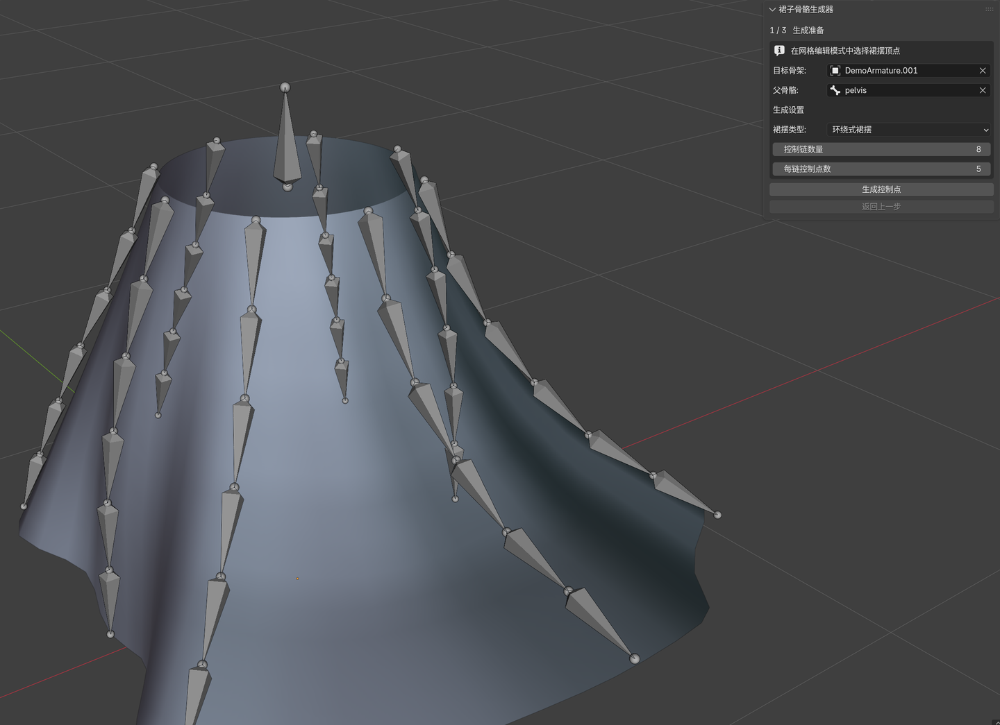
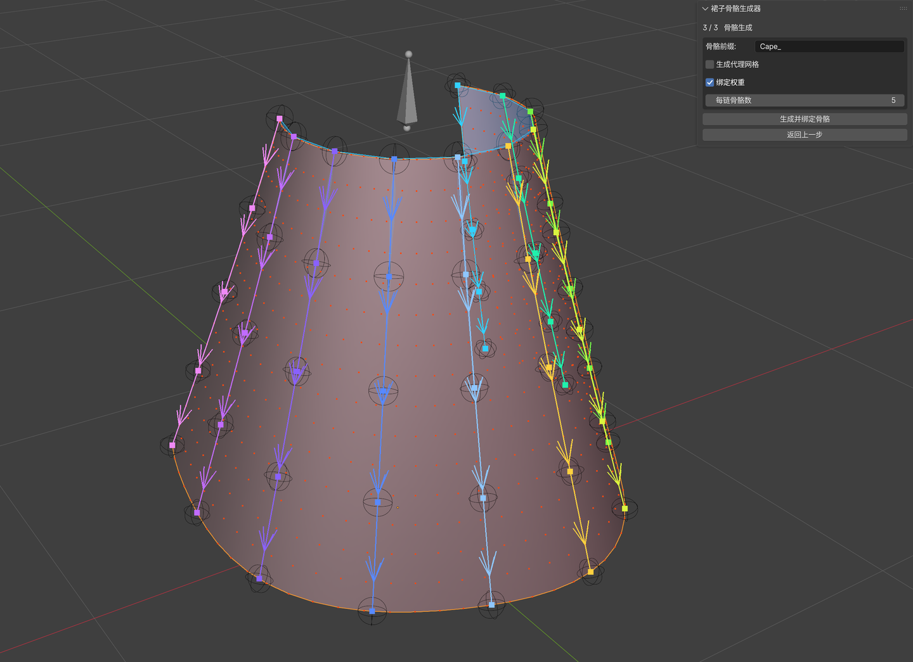

# 裙子骨骼生成器

适用于 **Blender 4.5+** 的裙摆与垂落布料自动绑骨插件。在网格编辑模式中选中顶点，通过三步流程即可完成控制链拟合、微调、等弧长骨骼生成与权重绑定。

## 功能特点

- 支持**环绕式裙摆**（闭合裙身）与**开放式裙摆**（围裙、披风、飘带等），支持多网格联合选区。
- 控制点编辑支持 **X / Y 镜像**、实时代理曲面预览、局部 `+Z` 轴向调整及多选反转骨链方向。
- 沿控制链等弧长生成相连骨骼，自动写入归一化权重并添加 `Armature` 修改器，可选输出代理网格。

## 安装

1. 下载发布包 `skirt_bone_generator-*.zip`。
2. 在 Blender 中打开 **编辑 > 偏好设置 > 插件**，选择 **从磁盘安装...** 并安装压缩包。
3. 启用 **裙子骨骼生成器**，在 3D 视图按 `N` 打开右侧边栏，切换到 **自动裙骨** 面板。

## 使用方法

### 1. 生成准备

在一个或多个网格的 **编辑模式** 中选中需要处理的顶点，在右侧边栏设置：

- **目标骨架 / 父骨骼**：选择目标骨架及第一层裙骨的父骨骼（顶部权重会自动混合到父骨骼）。
- **裙摆类型**：闭合裙身选 `环绕式裙摆`，围裙、披风等选 `开放式裙摆`。
- **控制链数量**（`4–24`）与 **每链控制点数**（`2–32`）。

点击 **生成控制点** 进入编辑阶段。

### 2. 控制点编辑

- 移动控制点调整骨链走向，旋转控制点调整骨骼局部 `+Z` 轴向。
- 点选任意控制点会自动高亮整条链；开启 **X 镜像 / Y 镜像** 后同步编辑并高亮对应链。
- 可按需勾选 **显示代理网格**、**显示网格点**、**显示轴向**，或使用 **反转选中链** 反转骨骼头尾与权重方向。

确认后点击 **完成控制点编辑**。

### 3. 骨骼生成

视口会显示选中顶点、全部高亮控制链、实时代理与逐骨方向箭头。设置：

- **骨骼前缀**：默认 `AutoSkirt_`，骨骼按 `{前缀}C{链号}_R{节号}` 命名。
- **每链骨骼数**（`1–64`）：调整时视口箭头与预览密度实时更新。
- **生成代理网格 / 绑定权重**：开启绑定后，目标网格和输出代理均会自动写入权重并添加骨架修改器。

点击 **生成并绑定骨骼** 完成生成，控制点会自动隐藏并回到第一步。

生成后可在姿态模式直接驱动变形：

### 开放式裙摆示例

单片规则四边形的开放布料会自动识别四角并沿布面边线等弧长布点，保留两侧自由边；多层、镂空或不规则拓扑会自动使用点云拟合。

## 注意事项

- **返回上一步**：从第三步返回会重置生成选项并重新打开控制点；从第二步返回会清除控制笼并恢复网格编辑模式，保留第一步配置。
- **多任务重建**：重建时按 **骨骼前缀** 清理旧生成项，同一骨架上的多个独立裙摆/披风任务请使用不同前缀。

## 参考

- 设计思路参考了 [曲面自動設定プラグイン](https://bowlroll.net/file/14991)。

## License

MIT
